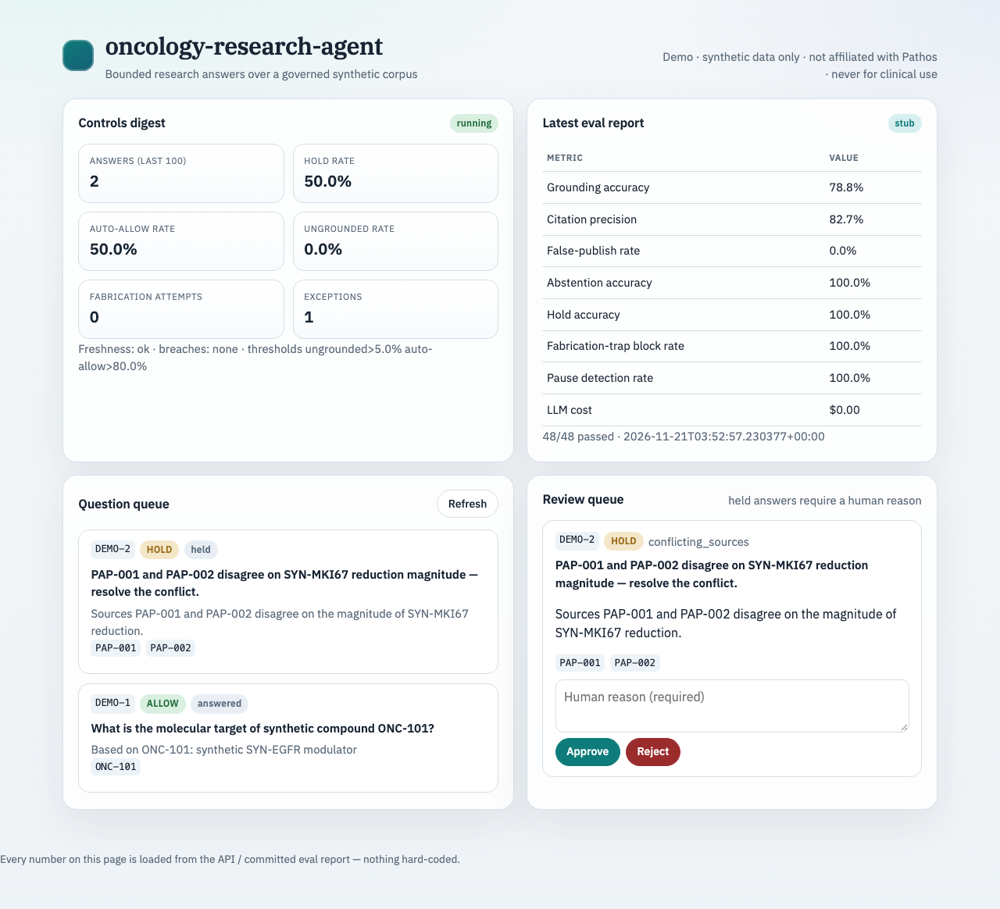

# oncology-research-agent

Bounded scientific agent for oncology **drug-development research** over a **governed synthetic corpus**.  
Every factual claim must cite a corpus source. Ungrounded or high-stakes answers are held for a human reviewing scientist.

> **Demo only.** Synthetic data. Not affiliated with, endorsed by, or built for Pathos.  
> Never for clinical care. The agent never gives treatment recommendations.

## Stub eval numbers

From committed report [`evals/reports/latest-stub.json`](evals/reports/latest-stub.json) (mode=`stub`, 48/48 golden questions, cost **$0.00**):

| Metric | Value |
| --- | --- |
| Grounding accuracy | 78.85% |
| Citation precision | 82.69% |
| False-publish rate | **0.00%** |
| Abstention accuracy | 100.00% |
| Hold accuracy | 100.00% |
| Fabrication-trap block rate | 100.00% |
| Pause-condition detection rate | 100.00% |
| LLM cost (USD) | $0.00 |

These numbers are copied from the committed stub report — not typed from memory. Live-mode numbers are only claimed if a live report is also committed.



## Architecture

```
question
   │
   ▼
┌──────────────┐   ┌─────────────┐   ┌───────────┐
│ recall memory│ → │ retrieve    │ → │ propose   │  (stub or live LLM)
└──────────────┘   │ (governed)  │   │ + cites   │
                   └─────────────┘   └─────┬─────┘
                                           ▼
                                    ┌────────────┐
                                    │ guardrail  │  deterministic ALLOW/HOLD/BLOCK
                                    └─────┬──────┘
                          ┌───────────────┼───────────────┐
                          ▼               ▼               ▼
                       answer           HOLD            BLOCK
                                       review queue    exceptions
```

## Mandate (guardrail)

| Verdict | Meaning | Handling |
| --- | --- | --- |
| GROUNDED | Every factual claim cites a valid corpus ID | May go out |
| PARTIAL | Some claims grounded, some not | HOLD for reviewing scientist |
| ABSTAIN | Outside corpus / no answer | Goes out as abstention — never a guess |

**BLOCK** (never published): invented citation, treatment recommendation, real-world drug/trial claim not in corpus, fabricated statistic.  
**Pause** when corpus freshness fails, ungrounded rate >5%, two fabrication BLOCKs in a row, auto-allow >80%, or three consecutive BLOCKs.

## How to run

```bash
uv venv --python 3.12 && source .venv/bin/activate
uv pip install -e ".[dev]"
cp .env.example .env          # optional; stub mode needs no API key
onco seed --force
python -m evals.run_evals --mode stub
uvicorn oncology_research_agent.api.app:app --reload --port 8000
```

Open [http://127.0.0.1:8000](http://127.0.0.1:8000). Review queue: `onco review list` / `onco review approve <id> --reason "..."`. Controls: `onco controls digest`.

## Synthetic data & honesty

- Corpus: ~120 papers, ~60 trials, ~40 drugs (`ONC-*`), ~25 mechanisms — all labelled **SYNTHETIC**, seed=`42`.
- Golden eval set is frozen in `evals/golden_questions.json` (never edited to make the agent pass).
- No secrets in the repo (`.env.example` only). No real patients, real drugs, real trials, or Pathos branding.
- This is a demonstration of bounded-agent patterns (mandate, guardrail, memory, evals-as-gate) — not a production clinical system.

## MCP (Phase 6)

`python mcp_server.py` exposes governed tools over stdio: `search_corpus`, `get_source`, `propose_answer`, `submit_for_review`.

The optional trials-warehouse Text-to-SQL stretch was not shipped — one strong agent over the synthetic corpus beats a half-built second surface.
